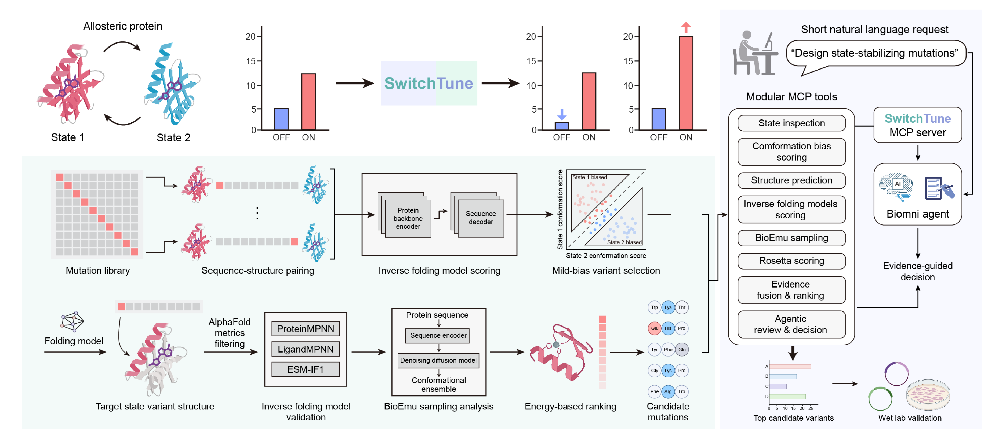

# SwitchTune



SwitchTune is a natural-language-driven framework for state-aware mutation design in conformational-switching proteins. It coordinates a Biomni scientific agent with modular MCP tools and records each computational decision, intermediate result and quality-control gate.

## What the workflow does

1. Inspect target and reference wild-type structures.
2. Select a mutation region from the observed state-dependent structural differences.
3. Build a saturation single-mutant library.
4. Score mutations in both states with ProteinMPNN or LigandMPNN.
5. Retain an empirical, moderate-bias fraction that adapts to the input library size.
6. Predict target-state variant structures with Boltz-2.
7. Apply confidence, PAE and state-similarity quality control.
8. Validate sequence-structure compatibility with ESM-IF1 and MPNN models.
9. Sample ensembles with BioEmu and evaluate energies with Rosetta.
10. Fuse evidence and return an adaptive shortlist of 20-30 candidates when enough valid variants remain.

The candidate budget is calculated from the valid evidence pool and is never fixed at 30. If fewer than 20 variants pass the available gates, SwitchTune reports the complete valid set.

## Repository layout

- `switchtune/mcp_server.py`: MCP tools for structure inspection, library generation, state-specific scoring, structure prediction, inverse folding, ensemble sampling, energy evaluation and evidence fusion.
- `switchtune/biomni_go_guard.py`: guarded Biomni handoff and checkpoint enforcement.
- `switchtune/biomni_mcp_adapter.py`: normalization layer between Biomni tool calls and SwitchTune MCP results.
- `switchtune/__init__.py`: package metadata and public import surface.
- `scripts/run_switchtune_agent_benchmark.py`: checkpointed agent runner that accepts the user's natural-language design prompt.
- `scripts/run_switchtune.sh`: minimal environment-variable launcher for a complete run.
- `scripts/checkpoint_workflow_runner.py`: resumable downstream checkpoint execution and review.
- `scripts/biomni_runtime.py`: Biomni agent construction and review-session utilities.
- `scripts/run_boltz2_local_batch.py`: local Boltz-2 batch execution helper.
- `scripts/run_boltz2_nim_batch.py`: hosted Boltz-2/NIM batch execution helper.
- `config/project_schema.yaml`: required inputs, including the natural-language `prompt`, and agent-decided fields.
- `config/switchtune.yaml`: default workflow and external-tool settings.
- `config/tool_registry.yaml`: executable names, paths and model backends.
- `config/decision_policy.yaml`: autonomous region, adaptive filtering and candidate-budget policies.
- `docs/installation.md`: environment setup and deployment instructions for Biomni and external models.
- `docs/configuration.md`: provider credentials, paths, prompt input and model settings.
- `docs/workflow.md`: checkpoint sequence, autonomous region selection and adaptive ranking behavior.
- `docs/architecture.md`: component boundaries and data flow.
- `docs/validation.md`: validation commands and expected checks.
- `prompts/switchtune_agent_prompt.md`: reusable blind-test agent instructions.
- `prompts/switchtune_agent_review_prompt.md`: checkpoint and final-review instructions.
- `assets/switchtune-workflow.png`: workflow overview figure.
- `mcp_config.example.yaml`: example MCP client registration.
- `.env.example`: template for user-supplied credentials and local model paths.
- `requirements.txt`: minimal Python dependencies.
- `pyproject.toml`: package metadata and tooling configuration.
- `tests/test_mcp_tools.py`: MCP tool contract tests.
- `tests/test_adaptive_cb_selection_to_structure_prediction.py`: adaptive filtering and handoff tests.
- `tests/test_structure_engine_selection_and_boltz_job.py`: structure-engine and Boltz-2 job tests.

## Quick start

```bash
git clone https://github.com/MJW0258/SwitchTune.git
cd SwitchTune
python -m venv .venv
source .venv/bin/activate
pip install -r requirements.txt
cp .env.example .env
```

Edit `.env` with the LLM provider settings and local model paths. API credentials are supplied by the user and are read from environment variables; no credentials are stored in the repository.

Run a design with only the required inputs:

```bash
export PROJECT_NAME=my_switch
export PROTEIN_NAME=MyProtein
export TARGET_STATE_STRUCTURE=/data/target_state.pdb
export REFERENCE_STATE_STRUCTURE=/data/reference_state.pdb
export TARGET_STATE_NAME=target_state
export REFERENCE_STATE_NAME=reference_state
export SWITCHTUNE_PROMPT="Design mutations that favor the target state while preserving reversible switching."
export SWITCHTUNE_LLM_MODEL=your-model-id
export SWITCHTUNE_LLM_API_KEY='your_api_key'
export SWITCHTUNE_LLM_SOURCE=Custom
export SWITCHTUNE_LLM_BASE_URL=https://your-provider.example/v1
bash scripts/run_switchtune.sh
```

The launcher intentionally contains no `MUTATION_REGION`. SwitchTune records the agent's selected region in `project_manifest.json` and `decision_log.jsonl`.

`SWITCHTUNE_PROMPT` (or `SWITCHTUNE_PROMPT_FILE`) is the required natural-language design request. It describes the desired state-specific behavior and constraints; the agent interprets it together with the supplied structures. For a longer request, set `SWITCHTUNE_PROMPT_FILE=/path/to/design_request.md` in the launcher or pass `--prompt_file` to the Python runner.

For a provider with a native Biomni integration, set `SWITCHTUNE_LLM_SOURCE` to the corresponding Biomni source and omit `SWITCHTUNE_LLM_BASE_URL` when it is not needed. For an OpenAI-compatible endpoint, use `Custom` and provide its base URL.

## MCP client configuration

Copy `mcp_config.example.yaml` to the configuration format required by your MCP client. Set `SWITCHTUNE_HOME` and `SWITCHTUNE_RUNS` in that client environment. The server command is:

```bash
python -m switchtune.mcp_server
```

## External models

The full installation guide covers Biomni, LigandMPNN, ProteinMPNN, ESM-IF1, BioEmu, Boltz-2 and Rosetta. These components are optional at setup time, but the stages that depend on an unavailable component will be recorded as pending or blocked rather than silently skipped.

## Security and data policy

Do not commit API keys, local absolute paths, generated run directories, private logs, model checkpoints or structure files whose redistribution is restricted. Keep credentials in an environment manager or an ignored `.env` file.

## Status

SwitchTune is research software. Model versions, GPU memory, licenses and external command-line interfaces can change. Every run writes a manifest and decision log so that failures can be inspected and stages can be resumed.
